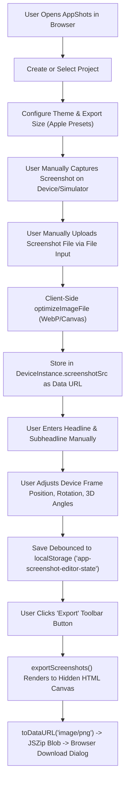
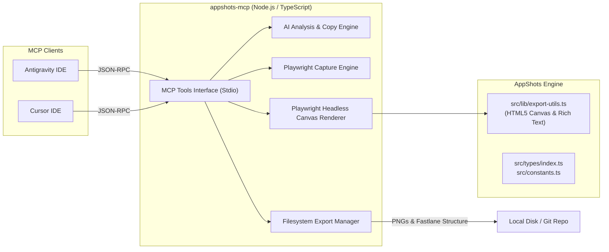
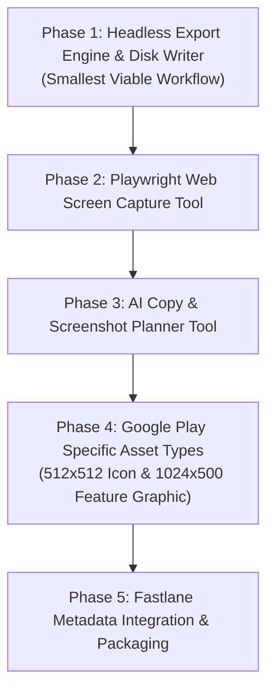

# AppShots MCP Automation — Capability Audit & Architecture Blueprint

**Date**: October 2026  
**Status**: Read-Only Audit & Design Specification  
**Target Environment**: Antigravity IDE, Cursor, Node.js / Bun MCP Runtime  

---

## 1. Executive Summary

AppShots is currently a client-only single-page application (React 19, Vite, TailwindCSS 4, TanStack Router) designed for manual composition and export of mobile store marketing screenshots. It features client-side HTML5 Canvas rendering, a rich-text engine, 2D/3D device frame mockups, and `localStorage` persistence.

To convert AppShots into an **MCP-powered app-store asset generation system** capable of:
1. Inspecting local projects or running URLs,
2. Capturing screens via browser automation,
3. Analyzing apps and generating marketing copy/plans with AI,
4. Populating projects and device frames, and
5. Exporting Google Play Store assets and package files to disk,

a **hybrid headless-canvas / MCP server architecture** is required. 

This audit evaluates the codebase's existing capabilities, identifies reusable modules versus missing components, defines concrete MCP tool schemas, and outlines a phased implementation strategy starting with the smallest viable end-to-end workflow.

---

## 2. Existing Architecture & Relevant Source Files

### 2.1 Technology Stack & Runtime
* **Runtime**: Client-side browser only (React 19.2.0, Vite 7.1.7).
* **Persisted Storage**: Browser `localStorage` key `app-screenshot-editor-state` (`PersistedEditorState`, schema version 2).
* **Canvas Rendering**: Custom HTML5 Canvas 2D rendering pipeline (`export-utils.ts`, `rich-text-canvas.ts`).
* **Archiving**: In-memory ZIP packaging via `JSZip` triggering browser `<a download>`.
* **Automation / AI Tools**: Currently **0%** present in the repository (no Playwright, Puppeteer, AI SDKs, or backend server).

### 2.2 Core Code Map
| Subsystem | Key Files | Purpose & Architectural Role |
| :--- | :--- | :--- |
| **Data Models** | [`src/types/index.ts`](file:///C:/Users/shank/OneDrive/Desktop/appshots/src/types/index.ts) | Canonical schemas for `Project`, `Screenshot`, `DeviceInstance`, `ImageOverlay`, `ExportSize`, `DeviceSpec`. |
| **Constants** | [`src/constants.ts`](file:///C:/Users/shank/OneDrive/Desktop/appshots/src/constants.ts) | Device specifications (iPhone 14/15, iPad Pro, Galaxy S24, Tab S9), gradient presets, export size presets. |
| **State & Lifecycle** | [`src/context/EditorContext.tsx`](file:///C:/Users/shank/OneDrive/Desktop/appshots/src/context/EditorContext.tsx) | Project CRUD, active screenshot/device selection, upload orchestration, error handling. |
| **Storage & Persistence**| [`src/lib/useLocalStorage.ts`](file:///C:/Users/shank/OneDrive/Desktop/appshots/src/lib/useLocalStorage.ts) | JSON schema serialization, validation, debounced auto-save, synchronous `beforeunload` guard. |
| **Export Engine** | [`src/lib/export-utils.ts`](file:///C:/Users/shank/OneDrive/Desktop/appshots/src/lib/export-utils.ts) | Canvas rendering of backgrounds, devices (flat/3D), shadows, text, overlays, and ZIP triggering. |
| **Text Rendering** | [`src/lib/rich-text-canvas.ts`](file:///C:/Users/shank/OneDrive/Desktop/appshots/src/lib/rich-text-canvas.ts) | HTML parsing (`DOMParser`), styled text metrics, multi-line wrapping, highlight badge rendering on canvas. |
| **Device Transforms** | [`src/lib/device-instances.ts`](file:///C:/Users/shank/OneDrive/Desktop/appshots/src/lib/device-instances.ts) | Device cloning, 2D/3D positioning, color mapping, fallback resolution. |
| **Multi-Device Flow** | [`src/lib/device-overflow.ts`](file:///C:/Users/shank/OneDrive/Desktop/appshots/src/lib/device-overflow.ts) | Cross-screenshot device overflow calculation for panoramic multi-slide layouts. |
| **Image Preprocessing**| [`src/lib/image-optimizer.ts`](file:///C:/Users/shank/OneDrive/Desktop/appshots/src/lib/image-optimizer.ts) | In-browser downscaling to WebP/PNG, dimension bounding, memory safety. |

---

## 3. Data Representation & Schemas

### 3.1 Project
```typescript
export type Project = {
  id: string;
  name: string;
  createdAt: number;
  updatedAt: number;
  screenshots: Screenshot[];
  selectedDeviceId: string;     // e.g. "samsung-galaxy-s24-ultra"
  selectedColorId: string;      // e.g. "titanium-black"
  exportSizeId: string;         // e.g. "6.7", "ipad"
  activeScreenshotId: string;
  headlineFontSize: number;     // default 72
  subheadlineFontSize: number;  // default 42
};
```

### 3.2 Screenshot & Device Instances
```typescript
export type Screenshot = {
  id: string;
  headline: string;              // HTML string supported (<b>, <mark>, <span>)
  subheadline: string;           // HTML string supported
  backgroundColor: string;       // Hex color (e.g. "#000000")
  backgroundMode: "solid" | "gradient" | "image";
  gradientPresetId: string | null;
  textColor: string;             // Hex color
  headlineX: number;             // Percent (0-100), default 50
  headlineY: number;             // Percent (0-100), default 10
  headlineWidth: number;         // Percent (0-100), default 80
  subheadlineX: number;          // Percent (0-100), default 50
  subheadlineY: number;          // Percent (0-100), default 18
  subheadlineWidth: number;      // Percent (0-100), default 80
  fontFamily: string;            // Google Font name (e.g. "Inter")
  overlayImages: ImageOverlay[]; // Decorative stickers or badges
  devices: DeviceInstance[];     // 1 or more device mockups
  activeDeviceId: string;
};

export type DeviceInstance = {
  id: string;
  deviceId: string;              // Matches DeviceSpec.id
  colorId: string;               // Matches DeviceColor.id
  screenshotSrc: string | null;  // Data URL (WebP/PNG) or image URL
  x: number;                     // Percent (0-100)
  y: number;                     // Percent (0-100)
  scale: number;                 // Percent (e.g. 85)
  rotation: number;              // Degrees (-180 to 180)
  shadow: ShadowConfig;
  style: "flat" | "3d";
  rotateY: number;               // 3D yaw angle (-45 to 45)
  rotateX: number;               // 3D pitch angle (-45 to 45)
};
```

### 3.3 Representation Findings
* **App Icon**: In the existing UI, "Icons" are decorative stickers (`/icons/*.png`) placed inside `overlayImages`. There is currently **no store listing App Icon generator** (512x512 PNG) or Google Play Feature Graphic generator (1024x500 PNG).
* **Google Play Export Dimensions**: `exportSizes` in `src/constants.ts` currently defines Apple App Store sizes (6.7", 6.5", 5.5", iPad 12.9"). Google Play specifications (e.g., 1080x1920 phone, 1080x2400 phone, 1200x1920 7" tablet, 1600x2560 10" tablet, 1024x500 feature graphic) are currently missing from presets.

---

## 4. Reusability Audit (Headless vs. Browser Bound)

| Module / Function | Pure / Reusable in Node? | Browser DOM Dependencies | Automation Recommendation |
| :--- | :---: | :--- | :--- |
| `createDefaultProject`, `createDefaultScreenshot`, `createDeviceInstance`, `cloneDeviceInstance` | **Yes (100% Pure)** | None | Extract into `@appshots/core` for direct use in Node/Bun MCP server. |
| `getRenderableDevicesForScreenshot`, `getDeviceLocalXForScreenshot`, `isDeviceVisibleInScreenshot` | **Yes (100% Pure)** | None | Reusable directly in Node/Bun for multi-screen layout calculations. |
| `calculateTargetDimensions` (`image-optimizer.ts`) | **Yes (100% Pure)** | None | Reusable directly for aspect ratio calculations. |
| `savePersistedState`, `loadPersistedState` | **Partial** | Depends on `localStorage` | In Node/Bun, replace with direct file I/O (`fs.readFile` / `fs.writeFile`). |
| `parseRichText` (`rich-text-canvas.ts`) | **No** | `DOMParser` | Can be run in Node using `@xmldom/xmldom` / `linkedom` or inside a headless browser context. |
| `drawRichText` (`rich-text-canvas.ts`) | **No** | `CanvasRenderingContext2D` | Requires a canvas context (`@napi-rs/canvas` or Playwright page evaluation). |
| `exportScreenshots` (`export-utils.ts`) | **No** | `document.createElement("canvas")`, `document.fonts.ready`, `new Image()`, `link.click()` | Best executed via Playwright headless browser evaluation or refactored with `@napi-rs/canvas`. |

---

## 5. Current End-to-End Asset Generation Workflow



### Critical Gaps in Current Workflow for Automated MCP Execution:
1. **No Ingestion**: No automated mechanism to capture screens from a local project or web URL.
2. **No AI Planning**: Copy, headlines, color palettes, and device framing are entirely manual.
3. **No File System Export**: Exported images are delivered solely through browser downloads, not written to project repository paths (`android/app/src/main/playstore/`, `fastlane/metadata/`, etc.).
4. **No Non-Interactive API**: The entire state and export pipeline is tied to React lifecycle hooks and DOM events.

---

## 6. Capability Matrix

| Feature / Step | Status | Existing Implementation | Required for MCP Automation |
| :--- | :---: | :--- | :--- |
| **Project Creation & Serialization** | **Available** | `EditorContext.tsx`, `useLocalStorage.ts` | Extract pure schema & state helpers into a headless Node module. |
| **Device Frame Mockups & Styles** | **Available** | Flat & 3D CSS/Canvas transforms for iPhone, Galaxy S24, iPad, Tab S9. | Direct canvas rendering logic exists; requires headless driver. |
| **Rich-Text Headline Formatting** | **Available** | HTML parsing, line wrapping, colored spans, `<mark>` highlights. | Headless canvas rendering or Playwright page execution. |
| **Multi-Device Overflow** | **Available** | Panoramic positioning across adjacent screenshots. | Reusable layout formulas. |
| **Google Play Export Dimensions** | **Missing** | Only Apple App Store sizes exist in `src/constants.ts`. | Add Play Store phone (1080x1920, 1080x2400) & tablet (1200x1920, 1600x2560) presets. |
| **App Icon Generation (512x512)** | **Missing** | Only sticker overlay library exists (`/icons/*.png`). | Implement standalone 512x512 Play Store icon generator. |
| **Feature Graphic (1024x500)** | **Missing** | Not supported in canvas dimensions or layout. | Implement 1024x500 landscape marketing graphic layout. |
| **App Inspection & Screen Capture**| **Missing** | None (client-only web app). | Add Playwright-based browser capture tool. |
| **AI Copy & Layout Generation** | **Missing** | None (manual input only). | Add AI provider integration (Gemini, Claude, or OpenAI) for copy & theme planning. |
| **Filesystem Export / Fastlane Output**| **Missing** | Browser `<a download>` and JSZip in-memory blob. | Write direct PNGs to target output directories on disk. |

---

## 7. Proposed MCP Server Architecture

To ensure maximum reliability without rewriting the complex, tested canvas rendering engine from scratch, the recommended architecture is an **MCP Server with a Headless Playwright Engine**:



### Why Playwright for MCP Rendering?
1. **Pixel-Perfect Parity**: The existing `export-utils.ts` and `rich-text-canvas.ts` use browser canvas font rendering, CSS 3D perspective projection matrices, and WebGL/DOM APIs. Replicating this in pure Node via Cairo/node-canvas frequently produces subtle font-metric and 3D skew mismatches.
2. **Zero Code Duplication**: Playwright launches a lightweight headless browser page that evaluates the existing AppShots rendering code directly in memory.
3. **Built-in Capture**: The same Playwright instance serves dual purposes: (1) capturing target app screens, and (2) rendering final store assets to PNG buffers and writing them directly to the user's filesystem.

---

## 8. Proposed MCP Tool Definitions

### Tool 1: `capture_app_screens`
* **Description**: Navigates to a running web application URL or mobile web view, simulates mobile viewports, and captures key application views as optimized PNG screenshots.
* **Input Schema**:
```json
{
  "type": "object",
  "properties": {
    "url": { "type": "string", "description": "Local or remote URL of the running application (e.g., http://localhost:5173)" },
    "screens": {
      "type": "array",
      "items": {
        "type": "object",
        "properties": {
          "name": { "type": "string", "description": "Identifier for the screen (e.g., 'home', 'dashboard', 'settings')" },
          "path": { "type": "string", "description": "URL path or hash to navigate to (e.g., '/dashboard')" },
          "waitForSelector": { "type": "string", "description": "Optional CSS selector to wait for before capturing" },
          "viewport": {
            "type": "object",
            "properties": {
              "width": { "type": "number", "default": 412 },
              "height": { "type": "number", "default": 915 },
              "deviceScaleFactor": { "type": "number", "default": 2.5 }
            }
          }
        },
        "required": ["name"]
      }
    },
    "outputDir": { "type": "string", "description": "Directory to store raw captured images" }
  },
  "required": ["url", "screens"]
}
```

### Tool 2: `generate_screenshot_plan`
* **Description**: Analyzes the application context, captured screens, and product description to generate a cohesive screenshot plan, compelling marketing headlines, subheadlines with rich-text highlights, theme gradients, and device framing recommendations.
* **Input Schema**:
```json
{
  "type": "object",
  "properties": {
    "productName": { "type": "string" },
    "productDescription": { "type": "string" },
    "targetAudience": { "type": "string" },
    "capturedScreens": {
      "type": "array",
      "items": {
        "type": "object",
        "properties": {
          "name": { "type": "string" },
          "filePath": { "type": "string" },
          "purpose": { "type": "string" }
        },
        "required": ["name", "filePath"]
      }
    },
    "targetStore": { "type": "string", "enum": ["google-play", "apple-app-store", "both"], "default": "google-play" },
    "themeStyle": { "type": "string", "enum": ["minimal-dark", "vibrant-gradient", "clean-light", "tech-neon"], "default": "vibrant-gradient" }
  },
  "required": ["productName", "capturedScreens"]
}
```

### Tool 3: `build_appshots_project`
* **Description**: Programmatically creates and populates an AppShots project JSON data structure with configured device instances, headlines, colors, and embedded or linked screenshot images.
* **Input Schema**:
```json
{
  "type": "object",
  "properties": {
    "projectName": { "type": "string" },
    "deviceId": { "type": "string", "enum": ["samsung-galaxy-s24-ultra", "iphone-15-pro-max", "iphone-15-pro", "ipad-pro-12-9", "samsung-galaxy-tab-s9"], "default": "samsung-galaxy-s24-ultra" },
    "deviceColorId": { "type": "string", "default": "titanium-black" },
    "exportSizeId": { "type": "string", "enum": ["play-phone-1080", "play-phone-1440", "play-tab-7", "play-tab-10", "6.7", "6.5", "ipad"], "default": "play-phone-1080" },
    "slides": {
      "type": "array",
      "items": {
        "type": "object",
        "properties": {
          "headline": { "type": "string", "description": "Headline text (HTML supported, e.g. 'Track your <b>finances</b>')" },
          "subheadline": { "type": "string", "description": "Supporting copy" },
          "screenshotFilePath": { "type": "string", "description": "Local path to the screenshot image" },
          "backgroundMode": { "type": "string", "enum": ["solid", "gradient"], "default": "gradient" },
          "gradientPresetId": { "type": "string", "default": "sunset" },
          "backgroundColor": { "type": "string", "default": "#000000" },
          "textColor": { "type": "string", "default": "#FFFFFF" },
          "deviceStyle": { "type": "string", "enum": ["flat", "3d"], "default": "flat" },
          "rotateY": { "type": "number", "default": 0 },
          "rotateX": { "type": "number", "default": 0 },
          "scale": { "type": "number", "default": 85 }
        },
        "required": ["headline", "subheadline", "screenshotFilePath"]
      }
    }
  },
  "required": ["projectName", "slides"]
}
```

### Tool 4: `export_store_assets`
* **Description**: Takes an AppShots project specification, renders each slide at full store resolution via headless canvas, and saves PNG files directly to the specified output directory (including Fastlane directory structure if requested).
* **Input Schema**:
```json
{
  "type": "object",
  "properties": {
    "project": { "type": "object", "description": "Complete Project data object (from build_appshots_project)" },
    "outputDir": { "type": "string", "description": "Target directory to write exported PNG assets" },
    "format": { "type": "string", "enum": ["flat-files", "fastlane-google-play", "fastlane-app-store"], "default": "fastlane-google-play" },
    "language": { "type": "string", "default": "en-US" }
  },
  "required": ["project", "outputDir"]
}
```

---

## 9. AI & Image-Generation Integration Boundaries

### 9.1 Boundary Strategy
To keep the MCP server modular, testable, and vendor-neutral:
1. **LLM Agnostic via Client or Direct API**:
   * *Option A (Client-native via Agent)*: Antigravity or Cursor can perform the planning reasoning directly in their primary agent turn and invoke `build_appshots_project` with the generated plan.
   * *Option B (Server-side configurable provider)*: The MCP server can accept standard environment variables (`GEMINI_API_KEY`, `ANTHROPIC_API_KEY`, or `OPENAI_API_KEY`) to run automated screenshot analysis and copy-writing in batch scripts.
2. **Vision Analysis of Captured Screens**:
   * Screen images captured by `capture_app_screens` are passed to a multimodal model (Gemini 1.5 Pro / Claude 3.5 Sonnet / GPT-4o) with a structured prompt instructing it to identify key UX moments (e.g. "Onboarding", "Analytics Dashboard", "Transaction Detail") and generate 4–6 word high-converting store headlines.
3. **No Direct Generative Image Hallucination**:
   * Product screenshots must represent authentic application functionality to comply with Google Play Developer Policies. The MCP server should capture real application screens, using AI exclusively for copy generation, highlighting keywords, theme harmonization, and composition planning.

---

## 10. Security, Filesystem & Configuration

### 10.1 Filesystem Boundaries
* **Path Validation**: All input and output file paths must be strictly checked against workspace boundaries. Rejection of directory traversal (`../`) and forbidden directories (`.git`, `node_modules`, system root).
* **Temporary Storage**: Intermediate captures and optimized data are saved to a dedicated scratch directory (`.appshots/cache/`) and cleaned up automatically.

### 10.2 API Key & Secret Management
* No API keys or tokens are stored in configuration files or code.
* Keys are read strictly from process environment variables passed by the client host (`GEMINI_API_KEY`, etc.).

### 10.3 MCP Client Configuration

#### Antigravity Configuration (`~/.gemini/antigravity/mcp/appshots.json` or workspace config)
```json
{
  "mcpServers": {
    "appshots": {
      "command": "bun",
      "args": ["run", "C:/path/to/appshots/mcp-server/src/index.ts"],
      "env": {
        "NODE_ENV": "production"
      }
    }
  }
}
```

#### Cursor Configuration (`~/.cursor/mcp.json` or `.cursor/mcp.json`)
```json
{
  "mcpServers": {
    "appshots": {
      "command": "node",
      "args": ["C:/path/to/appshots/mcp-server/dist/index.js"]
    }
  }
}
```

---

## 11. Testing Strategy & Acceptance Criteria

### 11.1 Test Matrix
1. **Core Data & Schema Unit Tests**:
   * Verify JSON serialization/deserialization matches `PersistedEditorState` (schema v2).
   * Verify Samsung Galaxy S24 Ultra & Google Play resolution calculations.
2. **Headless Canvas Rendering Tests**:
   * Render a sample project in headless Playwright; verify that exported PNGs have correct dimensions (1080x1920, 1440x3120, etc.), non-zero file sizes, and valid PNG magic headers (`\x89PNG`).
3. **MCP Tool Contract Tests**:
   * Test stdio JSON-RPC tool invocation for `build_appshots_project` and `export_store_assets`.
   * Test graceful error handling for missing files, invalid URLs, and unrecognized devices.
4. **Fastlane Output Layout Verification**:
   * Verify files written to `[outputDir]/phoneScreenshots/1_en-US.png`, `2_en-US.png`, etc.

### 11.2 Acceptance Criteria
- [ ] An agent in Antigravity or Cursor can call `capture_app_screens` against `http://localhost:5173` and receive captured PNG file paths.
- [ ] Calling `build_appshots_project` produces a valid project spec without requiring manual browser interaction.
- [ ] Calling `export_store_assets` renders pixel-accurate PNGs with device frames, headlines, and gradients directly to the workspace filesystem.
- [ ] The existing web application remains completely intact and functional.

---

## 12. Phased Implementation Plan



### Phase 1: Smallest Viable End-to-End Workflow (Recommended First Task)
* **Goal**: Enable an agent to programmatically assemble an AppShots project from existing images on disk and render full-resolution Google Play Store screenshot PNGs directly to a project directory.
* **Scope**:
  1. Add Google Play dimensions (`play-phone-1080`, `play-phone-1440`, `play-tab-7`, `play-tab-10`) to export specifications.
  2. Implement an MCP server package (e.g. `packages/mcp-server` or `mcp/`) with `build_appshots_project` and `export_store_assets`.
  3. Use headless Playwright to load the AppShots canvas renderer and write PNG buffers to disk.

### Phase 2: Screen Capture Automation
* Implement `capture_app_screens` using Playwright mobile emulation (Pixel 7 / Galaxy S24 viewport), capturing screens from local dev servers (`localhost`).

### Phase 3: AI Copy & Screenshot Planner
* Implement `generate_screenshot_plan` with multimodal analysis of captured screens and structured JSON copy generation.

### Phase 4: Extended Store Assets
* Add specialized canvas templates for Google Play Feature Graphics (1024x500) and App Icons (512x512).

### Phase 5: Fastlane & Store Delivery Integration
* Support automatic folder structuring (`android/app/src/main/playstore/`, `fastlane/metadata/android/`) ready for `supply` / automated store upload.

---

## 13. Audit Conclusion & Recommended First Task

* **Audit Conclusion**: AppShots has a mature, high-fidelity canvas rendering engine for flat and 3D device frames, rich typography, and multi-device panoramic layouts. However, because it was built as a client-side web application, it currently lacks headless rendering, automated capture, AI planning, and filesystem write capabilities.
* **Uncertainties**:
  - *Browser Runtime Requirement*: Running headless Playwright inside an MCP server requires Chromium to be installed on the host machine (`npx playwright install chromium`).
  - *Google Play Form Factors*: Google Play strictly requires specific aspect ratios (16:9 or 9:16) and minimum dimensions (1080px width recommended); new preset definitions must be added.
* **Recommended Next Action**: Proceed with **Phase 1 (Smallest Viable Workflow)**: build the core headless rendering and export MCP tools (`build_appshots_project` + `export_store_assets`) to verify that the canvas engine can generate store-ready PNGs on disk from an MCP tool call.
