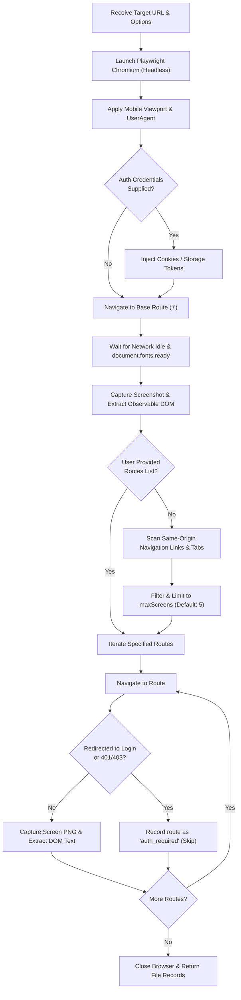
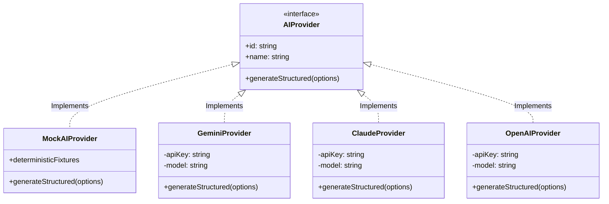
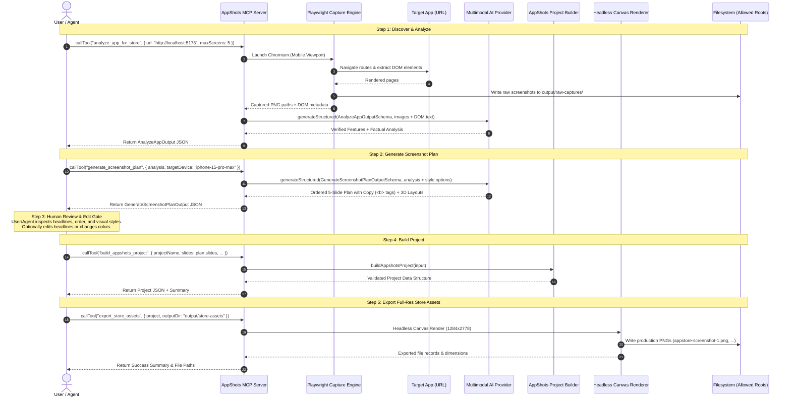
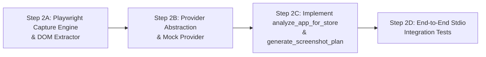

# AppShots MCP — Phase 2, Step 1: AI Analysis & Screenshot Planning Design Specification

**Document Version**: 1.0.0  
**Status**: Design & Audit Specification (Read-Only Architecture)  
**Target Environment**: Antigravity IDE, Cursor, Node.js / Bun MCP Runtime  
**Related Documents**: 
- [`docs/APPSHOTS_MCP_CAPABILITY_AUDIT.md`](file:///c:/Users/shank/OneDrive/Desktop/appshots/docs/APPSHOTS_MCP_CAPABILITY_AUDIT.md)
- [`docs/APPSHOTS_MCP_PHASE_1C_AUDIT.md`](file:///c:/Users/shank/OneDrive/Desktop/appshots/docs/APPSHOTS_MCP_PHASE_1C_AUDIT.md)
- [`docs/APPSHOTS_MCP_SETUP.md`](file:///c:/Users/shank/OneDrive/Desktop/appshots/docs/APPSHOTS_MCP_SETUP.md)

---

## 1. Executive Summary & Goals

Phase 1 established a hardened, headless export pipeline (`build_appshots_project` and `export_store_assets`), allowing external MCP clients (Antigravity and Cursor) to construct validated projects and render pixel-perfect, store-ready PNG screenshots directly to disk via Playwright Chromium.

**Phase 2** expands this foundation to enable **AI-powered, automated app-store screenshot generation** by introducing two new MCP tools:
1. `analyze_app_for_store`: Inspects a target web application (running URL or supported local project), navigates routes, captures representative mobile screens, extracts observable DOM product evidence, and produces a factual, hallucination-free application analysis.
2. `generate_screenshot_plan`: Ingests the factual analysis, synthesizes marketing messaging and user benefits, formats high-converting headlines (with HTML formatting tags like `<b>` and `<span>`), and outputs a structured, ordered screenshot plan that maps directly into the existing AppShots project model.

### Key Architectural Tenets
- **Zero Canvas/Renderer Duplication**: All device framing, typography, 2D/3D transforms, and export resolutions reuse the proven HTML5 canvas engine ([`src/lib/export-utils.ts`](file:///c:/Users/shank/OneDrive/Desktop/appshots/src/lib/export-utils.ts)) and schema models ([`src/types/index.ts`](file:///c:/Users/shank/OneDrive/Desktop/appshots/src/types/index.ts)).
- **Strict Anti-Hallucination & Fact-Checking**: The AI analysis must never invent product features, quantitative metrics, third-party integrations, customer testimonials, or unsupported marketing claims. All extracted features must cite concrete visual or DOM evidence.
- **Provider-Neutral AI Boundary**: The system defines an abstract interface for multimodal analysis and copy generation, allowing pluggable backends (Gemini, Claude, OpenAI, local Ollama) and a 100% deterministic mock provider for zero-cost unit testing.
- **Human-in-the-Loop Review Gate**: The generated plan is structured, transparent, and reviewable before invoking asset export, giving users and agents the opportunity to review, tweak headlines, or change color presets before rendering PNGs.

---

## 2. Task A: Target Application Inspection & Screen Capture

To produce high-quality app-store screenshots, the system must first capture realistic screen images and understand the product's value proposition.

### 2.1 Launch Safety & Target Types

| Target Mode | Safe by Default? | Operational Risk | Recommendation |
| :--- | :---: | :--- | :--- |
| **Running Application URL** (`http://localhost:...`, staging/production web URL) | **YES** | Low. Connects to an existing, already-running process. No arbitrary code execution on host. | **Primary & Recommended Target Mode.** |
| **Local Project Directory** (e.g. `C:/path/to/my-app`) | **NO** (Dynamic execution) / **YES** (Static inspection) | **High**. Automatically running `npm run dev` or arbitrary package scripts risks executing untrusted lifecycle hooks (`preinstall`, `postinstall`), daemon processes, port collisions, and unconstrained resource consumption. | **Support safe static inspection only** (reading `package.json`, public assets, route configs). Do **not** automatically execute arbitrary build or dev scripts without explicit user configuration. |

#### Limits of Safe Automatic Startup
1. **Framework Diversity**: Detecting whether a local folder is Next.js, Vite, Nuxt, Remix, Expo Web, or Flutter requires diverse heuristics.
2. **Environment & Dependency Requirements**: Modern apps require database connections, environment variables (`.env`), backend microservices, or authentication tokens that a headless tool cannot know in advance.
3. **Port Collisions & Process Leaks**: Starting uncontrolled subprocesses on fixed ports (e.g. 3000, 5173) can collide with active developer processes or leave zombie servers running.
4. **Conclusion**: `analyze_app_for_store` will accept either:
   - A **running URL** (`url`, preferred and default for dynamic screen capture).
   - An **existing directory of pre-captured screenshot images** (`screenshotDirectory`, strictly confined by Phase 1C filesystem boundaries).
   - An optional **local directory for static metadata enrichment** (`localDir`, read-only inspection of `package.json`, `app.json`, and web manifests).

### 2.2 Playwright Mobile Viewport Emulation

When capturing web applications, desktop viewports produce wide layouts unsuitable for phone mockups. Playwright must emulate authentic mobile device characteristics:

```typescript
export const MOBILE_CAPTURE_VIEWPORTS = {
  "iphone-15-pro": {
    width: 393,
    height: 852,
    deviceScaleFactor: 3, // Retina capture: 1179x2556 px
    isMobile: true,
    hasTouch: true,
    userAgent: "Mozilla/5.0 (iPhone; CPU iPhone OS 17_0 like Mac OS X) AppleWebKit/605.1.15 (KHTML, like Gecko) Version/17.0 Mobile/15E148 Safari/604.1",
  },
  "pixel-7": {
    width: 412,
    height: 915,
    deviceScaleFactor: 2.625, // 1080x2400 px
    isMobile: true,
    hasTouch: true,
    userAgent: "Mozilla/5.0 (Linux; Android 14; Pixel 7) AppleWebKit/537.36 (KHTML, like Gecko) Chrome/120.0.0.0 Mobile Safari/537.36",
  },
} as const;
```

A `deviceScaleFactor` of `2.5` to `3.0` ensures the resulting PNG screenshot is crisp and matches the high DPI expectations of App Store rendering engines.

### 2.3 Route Navigation & Screen Discovery Flow



### 2.4 Handling Protected & Unavailable Routes

1. **Authentication Detection**:
   - URL redirection to `/login`, `/signin`, `/auth`, or `/account/login`.
   - Presence of `input[type="password"]` or prominent "Sign In" forms.
   - HTTP status codes `401 Unauthorized` or `403 Forbidden`.
   - **Action**: When detected, the tool does **not** fail or crash. It records the route with status `"auth_required"` in `screens`, logs the protected route in `assumptionsAndUnknowns.authRequiredRoutes`, and proceeds to other accessible routes.
2. **Optional Auth Context**:
   - The tool supports an optional `authContext` parameter allowing callers to pass session cookies, bearer headers, or localStorage keys for inspecting private dashboards safely.
3. **Unavailable Routes & Network Failures**:
   - If a route returns 404, 500, or times out after 10 seconds, it is marked as `"failed"` with the specific error recorded in `screens[i].error`. Publicly accessible screens remain unaffected.

### 2.5 Observable Information Extraction & Multimodal Packaging

To give the AI model factual context without dumping massive DOM trees or reading unrelated code files:
1. **DOM Scrapers Extract**:
   - Page `<title>` and `<meta name="description">`.
   - Header hierarchy (`<h1>`, `<h2>`, `<h3>`).
   - Primary navigation labels (e.g. tabs: "Home", "Analytics", "Wallet", "Settings").
   - Action buttons and call-to-actions ("Deposit Funds", "Track Workout", "Generate Report").
   - Semantic landmarks (`<main>`, `<nav>`, `<aside>`).
2. **Confinement**: Extraction operates strictly within the active browser DOM page or files within the configured allowed input roots. Unrelated source files, test fixtures, and environment variables are never read.
3. **Multimodal Packaging**:
   - Each captured PNG is stored in the allowed output directory (e.g. `output/raw-captures/`).
   - For the AI provider, the image is encoded as a Base64 data URL (`image/png`).
   - The image is paired directly with the extracted DOM text for that specific screen, providing a tight visual-semantic bundle.

---

## 3. Task B: Design `analyze_app_for_store`

### 3.1 Tool Purpose
Analyzes an application to extract verified product capabilities, user benefits, and representative screens. It acts as the **factual anchor** for the entire asset generation pipeline.

### 3.2 Zod Input Schema (`AnalyzeAppInputSchema`)

```typescript
import { z } from "zod";

export const AnalyzeAppInputSchema = z.object({
  target: z.discriminatedUnion("type", [
    z.object({
      type: z.literal("url"),
      url: z.string().url().describe("HTTP/HTTPS URL of the running application to inspect (e.g. 'http://localhost:5173')"),
    }),
    z.object({
      type: z.literal("screenshot_dir"),
      directoryPath: z.string().describe("Local filesystem directory containing pre-captured app screenshot files"),
    }),
  ]).describe("Target application source to analyze"),

  routes: z.array(z.string()).optional().describe("Explicit route paths to inspect (e.g. ['/', '/dashboard', '/analytics', '/settings']). If omitted, links on the base page will be discovered automatically."),

  maxScreens: z.number().int().min(1).max(10).optional().default(5).describe("Maximum number of unique screens to capture and analyze (default: 5, max: 10)"),

  deviceViewport: z.enum(["iphone-15-pro", "pixel-7"]).optional().default("iphone-15-pro").describe("Mobile device viewport emulation preset for screen captures"),

  outputDir: z.string().optional().default("./output/raw-captures").describe("Filesystem directory to store captured raw screenshot PNGs (must reside within allowed output roots)"),

  authContext: z.object({
    cookies: z.array(z.object({
      name: z.string(),
      value: z.string(),
      domain: z.string().optional(),
      path: z.string().optional().default("/"),
    })).optional(),
    headers: z.record(z.string(), z.string()).optional(),
    localStorage: z.record(z.string(), z.string()).optional(),
  }).optional().describe("Optional authentication context for accessing authenticated app routes"),

  userProvidedContext: z.object({
    productName: z.string().optional().describe("Explicit product or brand name"),
    description: z.string().optional().describe("High-level product description or marketing brief"),
    targetAudience: z.string().optional().describe("Intended user persona or demographic"),
    category: z.string().optional().describe("App store category (e.g. 'Finance', 'Health & Fitness', 'Productivity')"),
    keyFeatures: z.array(z.string()).optional().describe("Specific features the user wants emphasized"),
  }).optional().describe("User-supplied product context to guide analysis and supplement observed data"),
});

export type AnalyzeAppInput = z.infer<typeof AnalyzeAppInputSchema>;
```

### 3.3 Zod Output Schema (`AnalyzeAppOutputSchema`)

```typescript
export const EvidenceSourceEnum = z.enum(["observed_dom", "observed_visual", "user_provided", "inferred"]);

export const ObservedScreenSchema = z.object({
  id: z.string().describe("Unique identifier for this captured screen (e.g. 'screen-1-dashboard')"),
  route: z.string().describe("URL path or filename where screen was captured"),
  filePath: z.string().describe("Local filesystem path to the captured PNG screenshot"),
  title: z.string().describe("Observed page title or prominent header"),
  keyElements: z.array(z.string()).describe("List of prominent UI elements observed on screen (e.g. 'Bar chart of weekly activity', 'Recent transactions list')"),
  status: z.enum(["captured", "auth_required", "failed"]).describe("Capture status of this screen"),
  error: z.string().nullable().optional().describe("Failure reason if status is not 'captured'"),
});

export const VerifiedFeatureSchema = z.object({
  featureTitle: z.string().describe("Concise feature name (e.g. 'Interactive Financial Analytics')"),
  description: z.string().describe("What the feature does from a user benefit perspective"),
  evidence: z.string().describe("Specific observable evidence supporting this feature (e.g. 'Found on /analytics: interactive monthly expenditure bar chart with filtering by category')"),
  evidenceSource: EvidenceSourceEnum.describe("Origin of this feature verification"),
  screenId: z.string().describe("Reference to the screen ID demonstrating this feature"),
});

export const AnalyzeAppOutputSchema = z.object({
  product: z.object({
    name: z.string().describe("Verified product name"),
    nameSource: EvidenceSourceEnum,
    category: z.string().describe("App store category"),
    categorySource: EvidenceSourceEnum,
    tagline: z.string().nullable().describe("Observed or derived one-line product punchline"),
    summary: z.string().describe("2-3 sentence overview of what the application does"),
  }),
  screens: z.array(ObservedScreenSchema).min(1).describe("List of captured screens and their status"),
  features: z.array(VerifiedFeatureSchema).min(1).describe("Verified features backed by observable evidence"),
  targetAudience: z.object({
    description: z.string().describe("Description of who this app is for"),
    source: EvidenceSourceEnum,
    confidence: z.enum(["high", "medium", "low"]),
    rationale: z.string().describe("Why this audience was identified (citing observed UI, terminology, or user context)"),
  }),
  assumptionsAndUnknowns: z.object({
    unverifiedClaims: z.array(z.string()).describe("Claims in user-provided context that could not be corroborated from accessible screens"),
    authRequiredRoutes: z.array(z.string()).describe("Routes that could not be inspected because authentication is required"),
    areasRequiringUserConfirmation: z.array(z.string()).describe("Questions or ambiguities requiring user confirmation before marketing claims are published"),
  }),
  summary: z.string().describe("Human-readable executive summary of the analysis findings"),
});

export type AnalyzeAppOutput = z.infer<typeof AnalyzeAppOutputSchema>;
```

### 3.4 Anti-Hallucination Guardrails
1. **Source Tracking on All Entities**: Every product attribute, feature, and audience demographic has an explicit `EvidenceSourceEnum` tag.
2. **Concrete Evidence Strings**: Every entry in `features` must populate `evidence` with the exact DOM text or visual element found on a specific screen ID.
3. **Forbidden Inventions**:
   - NEVER generate fake metrics (e.g. "Trusted by 100,000+ users" or "99.9% uptime") unless explicitly found in the DOM or provided by the user.
   - NEVER invent unsupported integrations (e.g. "Syncs with Slack & Salesforce") unless verified.
   - NEVER generate fake testimonials or star ratings.
   - Any claim that cannot be proven from the captured screens is filed under `assumptionsAndUnknowns.unverifiedClaims`.

---

## 4. Task C: Design `generate_screenshot_plan`

### 4.1 Tool Purpose
Consumes the factual `AnalyzeAppOutput` and designs a complete, ordered sequence of marketing screenshot slides. It determines:
- Which screen best supports which value proposition.
- The high-converting headline (with HTML emphasis tags).
- Device framing (flat vs. 3D, scale, tilt, rotation).
- Color themes and gradient presets from AppShots' supported palettes.

### 4.2 Zod Input Schema (`GenerateScreenshotPlanInputSchema`)

```typescript
import { z } from "zod";
import { AnalyzeAppOutputSchema } from "./analyze-app-schema";

const validDeviceIds = [
  "iphone-15-pro-max",
  "iphone-15-pro",
  "iphone-14",
  "ipad-pro-12-9",
  "samsung-galaxy-s24-ultra",
  "samsung-galaxy-tab-s9",
] as const;

const validExportSizeIds = ["6.7", "6.5", "5.5", "ipad"] as const;

export const GenerateScreenshotPlanInputSchema = z.object({
  analysis: AnalyzeAppOutputSchema.describe("Output from analyze_app_for_store or a compliant structured analysis object"),

  targetStore: z.enum(["apple-app-store", "google-play"]).optional().default("apple-app-store").describe("Target app store listing"),

  targetDevice: z.enum(validDeviceIds).optional().default("iphone-15-pro-max").describe("Target device mockup frame model"),

  deviceColorId: z.string().optional().describe("Device color variant ID (e.g. 'black', 'natural', 'blue', 'white')"),

  exportSizeId: z.enum(validExportSizeIds).optional().default("6.7").describe("Target export dimension preset (matches AppShots export sizes)"),

  slideCount: z.number().int().min(1).max(7).optional().default(5).describe("Desired number of screenshot slides in the plan (1-7, default 5)"),

  themePreference: z.object({
    style: z.enum(["vibrant-gradient", "minimal-dark", "clean-light", "custom"]).optional().default("vibrant-gradient"),
    primaryGradientPresetId: z.enum(["sunset", "ocean", "mint", "berry", "royal", "rose"]).optional(),
    backgroundColor: z.string().regex(/^#[0-9a-fA-F]{6}$/).optional(),
    textColor: z.string().regex(/^#[0-9a-fA-F]{6}$/).optional(),
    fontFamily: z.string().optional().default("Inter"),
  }).optional().describe("Aesthetic and brand styling preferences"),

  customCopyOverrides: z.array(z.object({
    slideIndex: z.number().int().min(1),
    headline: z.string().optional(),
    subheadline: z.string().optional(),
  })).optional().describe("Optional user overrides for specific slide headlines or subheadlines"),
});

export type GenerateScreenshotPlanInput = z.infer<typeof GenerateScreenshotPlanInputSchema>;
```

### 4.3 Zod Output Schema (`GenerateScreenshotPlanOutputSchema`)

```typescript
export const PlannedSlideSchema = z.object({
  slideNumber: z.number().int().min(1).describe("Slide sequence index (1-based)"),
  screenshotRef: z.object({
    screenId: z.string().describe("ID of the referenced screen from analysis"),
    filePath: z.string().describe("Local filesystem path to the screenshot image file"),
    route: z.string().describe("Associated route of this screen"),
  }),
  marketingAngle: z.object({
    mainMessage: z.string().describe("Core marketing objective for this slide (e.g. 'Hero Value Proposition', 'Feature Deep Dive', 'Security & Trust')"),
    userBenefit: z.string().describe("Direct benefit to the user conveyed by this slide"),
    supportingEvidence: z.string().describe("Observed app evidence that justifies this benefit"),
  }),
  copy: z.object({
    headline: z.string().describe("Marketing headline (supports rich-text HTML <b>, <span>, e.g. 'Track your <b>finances</b>')"),
    subheadline: z.string().describe("Supporting subheadline text providing context or action"),
  }),
  visualComposition: z.object({
    deviceStyle: z.enum(["flat", "3d"]).describe("Device mockup render style"),
    deviceScale: z.number().min(20).max(150).describe("Device frame scale percentage (typically 80-85)"),
    deviceOffsetY: z.number().min(-50).max(100).describe("Device vertical position percentage (typically 30-40)"),
    deviceRotation: z.number().min(-180).max(180).describe("2D rotation angle in degrees"),
    rotateY: z.number().min(-45).max(45).describe("3D yaw angle in degrees (-45 to 45)"),
    rotateX: z.number().min(-45).max(45).describe("3D pitch angle in degrees (-45 to 45)"),
    backgroundMode: z.enum(["solid", "gradient"]).describe("Background style"),
    gradientPresetId: z.enum(["sunset", "ocean", "mint", "berry", "royal", "rose"]).nullable().describe("Gradient preset ID"),
    backgroundColor: z.string().describe("Hex background color"),
    textColor: z.string().describe("Hex text color"),
  }),
  missingInformationOrAction: z.string().nullable().describe("Any missing mock data, blur action, or manual review required before store submission"),
});

export const GenerateScreenshotPlanOutputSchema = z.object({
  planId: z.string().describe("Unique identifier for this generated screenshot plan"),
  projectName: z.string().describe("Generated project title"),
  targetStore: z.enum(["apple-app-store", "google-play"]),
  deviceModel: z.string(),
  deviceColor: z.string(),
  exportSizeId: z.string(),
  overallTheme: z.object({
    fontFamily: z.string(),
    headlineFontSize: z.number(),
    subheadlineFontSize: z.number(),
    primaryGradientId: z.string().nullable(),
    dominantColor: z.string(),
  }),
  slides: z.array(PlannedSlideSchema).min(1).describe("Ordered sequence of planned screenshot slides"),
  summary: z.string().describe("Executive rationale explaining the slide order, messaging progression, and visual dynamics"),
  readyForProjectBuilder: z.boolean().describe("Whether this plan can be passed directly to build_appshots_project"),
});

export type GenerateScreenshotPlanOutput = z.infer<typeof GenerateScreenshotPlanOutputSchema>;
```

### 4.4 1:1 Mapping to `build_appshots_project`

The `visualComposition`, `copy`, and `screenshotRef` fields in `PlannedSlideSchema` are intentionally designed to map directly into `SlideInputSchema` in [`src/mcp/project-builder.ts`](file:///c:/Users/shank/OneDrive/Desktop/appshots/src/mcp/project-builder.ts#L33):

```typescript
// Seamless conversion from PlannedSlide to BuildProjectInput slide:
const buildProjectSlide = {
  screenshotPath: plannedSlide.screenshotRef.filePath,
  headline: plannedSlide.copy.headline,
  subheadline: plannedSlide.copy.subheadline,
  backgroundMode: plannedSlide.visualComposition.backgroundMode,
  gradientPresetId: plannedSlide.visualComposition.gradientPresetId ?? "sunset",
  backgroundColor: plannedSlide.visualComposition.backgroundColor,
  textColor: plannedSlide.visualComposition.textColor,
  deviceStyle: plannedSlide.visualComposition.deviceStyle,
  deviceScale: plannedSlide.visualComposition.deviceScale,
  deviceOffsetY: plannedSlide.visualComposition.deviceOffsetY,
  deviceRotation: plannedSlide.visualComposition.deviceRotation,
  rotateY: plannedSlide.visualComposition.rotateY,
  rotateX: plannedSlide.visualComposition.rotateX,
};
```

This guarantees **zero impedance mismatch** between the planning output and project compilation.

---

## 5. Task D: AI Provider Boundary & Abstraction

To ensure vendor neutrality, avoid hardcoded SDK dependencies, and protect proprietary keys, all AI operations are decoupled behind a lightweight abstraction.

### 5.1 Provider-Neutral Interface (`AIProvider`)

```typescript
export interface MultimodalContentPart {
  type: "text" | "image";
  text?: string;
  mediaType?: "image/png" | "image/jpeg" | "image/webp";
  data?: string; // Base64 encoded bytes
}

export interface MultimodalMessage {
  role: "system" | "user" | "assistant";
  content: MultimodalContentPart[] | string;
}

export interface StructuredGenerateOptions<T> {
  systemPrompt: string;
  messages: MultimodalMessage[];
  schema: z.ZodType<T>;
  schemaName: string;
  temperature?: number;
  maxTokens?: number;
  timeoutMs?: number;
}

export interface StructuredGenerateResult<T> {
  data: T;
  rawText: string;
  usage?: {
    promptTokens: number;
    completionTokens: number;
  };
}

export interface AIProvider {
  readonly id: string;
  readonly name: string;
  generateStructured<T>(options: StructuredGenerateOptions<T>): Promise<StructuredGenerateResult<T>>;
}
```

### 5.2 Supported Provider Adapters



1. **`MockAIProvider` (Default in Test Environment)**:
   - Returns deterministic, valid mock data matching `AnalyzeAppOutputSchema` and `GenerateScreenshotPlanOutputSchema`.
   - Requires zero network calls, zero API keys, and incurs zero financial cost.
   - Used for all CI/CD unit and integration tests.
2. **`GeminiProvider` (Google Gemini 1.5 Flash / Pro)**:
   - Uses `GEMINI_API_KEY`.
   - Native support for structured JSON schema response formatting via `responseMimeType: "application/json"`.
   - High multimodal token capacity (1M+ tokens), ideal for feeding multiple high-res mobile screenshots simultaneously.
3. **`ClaudeProvider` (Anthropic Claude 3.5 Sonnet)**:
   - Uses `ANTHROPIC_API_KEY`.
   - Strong visual comprehension and copy formatting.
4. **`OpenAIProvider` (GPT-4o / GPT-4o-mini)**:
   - Uses `OPENAI_API_KEY`.
   - Supports native Structured Outputs (`json_schema`).

### 5.3 Resilience, Retries, and Error Handling
- **Timeout**: Enforce a strict 45-second abort signal on all outbound model requests.
- **Rate Limit Handling (HTTP 429)**: Automatic exponential backoff with jitter (initial delay 1.5s, multiplier 2, max 3 attempts).
- **JSON Parsing & Schema Validation**:
  - If the model response fails Zod schema parsing, the adapter issues a single "repair" request containing the parsing error message, asking the model to fix the malformed keys.
  - If it fails again, a clean error is returned with `isError: true` without crashing the MCP server process.
- **Secret Redaction**:
  - API keys are read strictly from process environment variables (`process.env.GEMINI_API_KEY`, etc.).
  - Diagnostic logs and error messages pass through a redaction filter replacing any key fragments with `[REDACTED]`.

---

## 6. Task E: End-to-End Orchestration Workflow



### Why the Review Gate (Step 3) is Vital
1. **App Store Compliance**: Apple App Review Guidelines (Section 2.3) and Google Play Store Listing Policies require that marketing screenshots accurately represent the real app experience.
2. **Editorial Control**: Marketing headlines are high-stakes brand assets. The two-phase separation (`analyze` + `plan` -> review -> `build` + `export`) ensures humans or supervisory agents retain final veto power over wording before final rendering.

---

## 7. Security Boundaries & Filesystem Confinement

The Phase 2 tools strictly inherit the security boundaries implemented and tested in Phase 1C:

1. **Input Image Validation**:
   - Pre-captured screenshot directories passed to `analyze_app_for_store` must pass [`validateInputFilePath()`](file:///c:/Users/shank/OneDrive/Desktop/appshots/src/mcp/security.ts#L182) and reside inside allowed input roots.
   - UNC paths (`\\server\share`) and symlink escapes are rejected.
2. **Raw Capture Output Confinement**:
   - Captured screenshots are written strictly to paths validated by [`validateOutputDirectoryPath()`](file:///c:/Users/shank/OneDrive/Desktop/appshots/src/mcp/security.ts#L251) (defaults to `<workspace>/output/raw-captures/` or `<workspace>/tmp/`).
   - Writes to `.git`, `node_modules`, or project `src/` are blocked.
3. **Error Sanitization**:
   - Any runtime capture errors or network timeouts pass through [`sanitizePathForError()`](file:///c:/Users/shank/OneDrive/Desktop/appshots/src/mcp/security.ts#L118) to prevent leaking local usernames or system paths to LLM clients.

---

## 8. Code Map: Existing Reusable Source vs. New Phase 2 Components

| Component / File | Current Status | Role in Phase 2 |
| :--- | :---: | :--- |
| [`src/types/index.ts`](file:///c:/Users/shank/OneDrive/Desktop/appshots/src/types/index.ts) | **Existing** | Canonical data types (`Project`, `Screenshot`, `DeviceInstance`, `ExportSize`). Unchanged. |
| [`src/constants.ts`](file:///c:/Users/shank/OneDrive/Desktop/appshots/src/constants.ts) | **Existing** | Device specs, gradient presets, export sizes. Unchanged. |
| [`src/mcp/security.ts`](file:///c:/Users/shank/OneDrive/Desktop/appshots/src/mcp/security.ts) | **Existing** | Path validation, boundary containment, sanitization. Reused directly. |
| [`src/mcp/lifecycle.ts`](file:///c:/Users/shank/OneDrive/Desktop/appshots/src/mcp/lifecycle.ts) | **Existing** | Graceful shutdown hooks and resource cleanup. Reused directly. |
| [`src/mcp/project-builder.ts`](file:///c:/Users/shank/OneDrive/Desktop/appshots/src/mcp/project-builder.ts) | **Existing** | `buildAppshotsProject()`. Ingests the plan output. Unchanged. |
| [`src/mcp/asset-exporter.ts`](file:///c:/Users/shank/OneDrive/Desktop/appshots/src/mcp/asset-exporter.ts) | **Existing** | `exportStoreAssets()`. Renders PNGs to disk. Unchanged. |
| `src/mcp/ai/provider.ts` | **New** | Abstract `AIProvider` interface and factory. |
| `src/mcp/ai/mock-provider.ts` | **New** | Deterministic mock provider for offline tests. |
| `src/mcp/capture/page-crawler.ts` | **New** | Playwright mobile screen capture & DOM scraper. |
| `src/mcp/tools/analyze-app.ts` | **New** | Implementation of `analyze_app_for_store` tool. |
| `src/mcp/tools/generate-plan.ts` | **New** | Implementation of `generate_screenshot_plan` tool. |

---

## 9. Phased Implementation Roadmap & Acceptance Criteria



### Acceptance Criteria for Phase 2 Implementation:
1. **`analyze_app_for_store`**:
   - When given a running web URL (e.g. `http://localhost:5173`), captures up to `maxScreens` PNG images to disk.
   - Returns a validated `AnalyzeAppOutput` object conforming to the Zod schema.
   - Distinguishes observed DOM features from user-provided context.
   - Never crashes on auth-redirected (401/403) or 404 pages.
2. **`generate_screenshot_plan`**:
   - Takes `AnalyzeAppOutput` and returns an ordered sequence of 1–7 slides.
   - Formats marketing headlines with valid HTML emphasis tags (`<b>`, `<span>`).
   - Assigns supported device models (`iphone-15-pro-max`, etc.) and gradient presets (`sunset`, `ocean`, etc.).
   - Can be fed directly into `build_appshots_project` without manual data transformation.
3. **Testing**:
   - 100% of unit and integration tests run offline using `MockAIProvider` without API keys.
   - All tests pass in `vitest run` and `bun run build` succeeds with 0 TypeScript errors.

---

## 10. Uncertainties & Explicit Decisions Requiring Approval

The following architectural choices are documented here for explicit review before proceeding to implementation:

1. **Default AI Provider Selection**:
   - *Decision*: When live AI analysis is enabled, which provider should be the primary default when keys are present: Google Gemini (`GEMINI_API_KEY`), Anthropic Claude (`ANTHROPIC_API_KEY`), or OpenAI (`OPENAI_API_KEY`)?
   - *Recommendation*: Support auto-detection based on whichever key is present in `process.env`, defaulting to Gemini 1.5 Flash for cost-efficiency and fast multimodal processing.
2. **Google Play Presets**:
   - *Decision*: Should custom Google Play phone resolutions (1080x1920, 1080x2400) be added to `src/constants.ts` during Phase 2 or deferred to Phase 4?
   - *Recommendation*: Keep Phase 2 strictly aligned with the existing, verified Apple/iPad export presets (6.7", 6.5", 5.5", iPad). Add Google Play specific presets in Phase 4 once the AI workflow is proven.
3. **Capture Viewport Defaults**:
   - *Decision*: Default viewport emulation for capturing web apps.
   - *Recommendation*: Default to iPhone 15 Pro (393x852 @ 3x = 1179x2556) to ensure crisp high-resolution screenshots that fit cleanly into the 6.7" iPhone frame.

---

## 11. Recommended Next Implementation Task

**Recommended Next Task**: **Implement Phase 2, Step 2A: Playwright Screen Capture & DOM Evidence Extraction Engine**.

### Scope of Step 2A:
1. Create `src/mcp/capture/page-crawler.ts` implementing headless mobile Chromium navigation, viewport configuration, and screenshot capture to allowed output roots.
2. Implement DOM evidence extraction (page titles, headers, navigation tabs, buttons).
3. Implement graceful handling of 401/403 auth redirects, 404 errors, and navigation timeouts.
4. Add comprehensive unit and integration tests (`src/mcp/capture/page-crawler.test.ts`) verifying that a local server or test fixture can be crawled and screens captured safely to disk.
