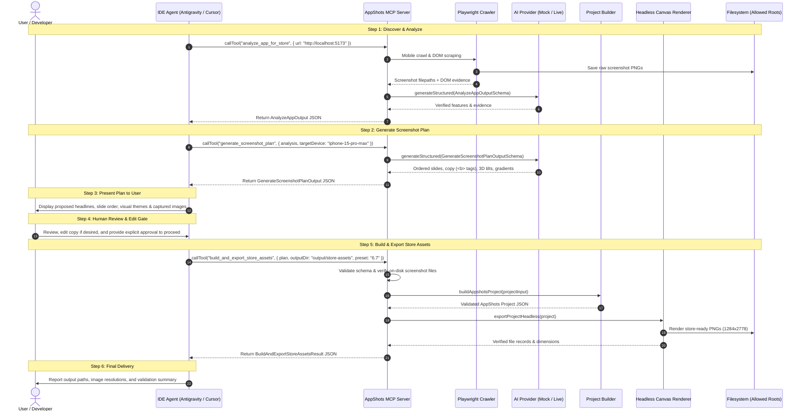

# AppShots MCP — Phase 2, Step 2D: Approved Plan-to-Export Pipeline Bridge Report

**Date**: October 20, 2026  
**Status**: Completed  
**Objective**: Connect the existing app analysis, screenshot planning, project builder, and asset exporter into a reliable workflow that produces real screenshot files from an explicitly reviewed plan.

---

## 1. Executive Summary

Phase 2, Step 2D implements the final pipeline bridge of Phase 2 by introducing and registering the fifth MCP tool: **`build_and_export_store_assets`**.

This tool connects the output of `generate_screenshot_plan` (after user review) directly into the core project construction (`buildAppshotsProject`) and headless canvas export engine (`exportStoreAssets`), eliminating manual data wrangling while strictly enforcing human-in-the-loop review boundaries.

### Core Achievements
1. **New MCP Tool `build_and_export_store_assets`**:
   - Accepts a reviewed screenshot plan (as a structured object or JSON string), target project name, supported export preset, target output directory, and optional filename prefix.
   - Reuses existing `buildAppshotsProject` and `exportStoreAssets` implementations with zero canvas/renderer duplication.
   - Emits structured metadata documenting each exported slide, dimensions, file paths, and preserved marketing angles.
2. **Strict Human-in-the-Loop Review Gate**:
   - The tool does not automatically trigger upon plan generation.
   - The IDE agent must present the plan to the user, wait for explicit user approval (or manual edits), and only then invoke `build_and_export_store_assets`.
   - The tool does not rely on a superficial boolean flag to fabricate user consent; execution is an intentional, separate tool call.
3. **Faithful Content & Style Preservation**:
   - Preserves headlines and subheadlines exactly, including rich-text formatting tags (e.g., `<b>...</b>`, `<span>...</span>`).
   - Maps 3D device orientations (`rotateX`, `rotateY`, `deviceRotation`), offsets, scales, and gradient presets directly to the project model.
   - Rejects unsupported values (e.g. invalid gradient presets) rather than silently dropping them.
4. **Store Integrity & Google Play Guardrails**:
   - Does not misreport Apple-sized screenshots as Google Play-ready.
   - If a plan targets `google-play` or an unsupported preset, the bridge immediately rejects the request with an explicit error explaining that Google Play dimensions are not yet implemented.
5. **Security & Headless Confinement**:
   - Reuses existing path security helpers (`validateInputFilePath`, `validateOutputDirectoryPath`, `validateFilenamePrefix`).
   - Enforces workspace input/output containment, path traversal prevention, and error sanitization.
   - Ensures Chromium instances and temporary Vite dev servers are cleanly terminated after success, failure, or cancellation.

---

## 2. End-to-End Workflow Contract

The AppShots MCP architecture defines a strict 6-step agent workflow:



### Protocol Invariant: Review Gate Separation
The export tool must not be called immediately by an autonomous loop without user interaction. The plan returned in Step 2 is an intermediate specification; Step 5 consumes the finalized, approved specification.

---

## 3. Tool Specification & Schema

### `build_and_export_store_assets`

- **MCP Tool Name**: `build_and_export_store_assets`
- **Description**: "Build and export verified, full-resolution store-ready PNG screenshots directly from an explicitly approved screenshot plan."
- **Input Parameters (`BuildAndExportStoreAssetsInputSchema`)**:

| Parameter | Type | Required | Description |
| :--- | :---: | :---: | :--- |
| `projectName` | `string` | Optional | Name of the project (defaults to `plan.projectName` if omitted). |
| `plan` | `GenerateScreenshotPlanOutput` \| `Record<string, unknown>` \| `string` | **Required** | Validated screenshot plan produced by `generate_screenshot_plan` and reviewed by the user. |
| `preset` | `string` | Optional | Supported export preset ID (`6.7`, `6.5`, `5.5`, `ipad`). Defaults to `plan.exportSizeId`. |
| `exportSizeId` | `string` | Optional | Alias for `preset`. |
| `outputDir` | `string` | **Required** | Target local filesystem directory to write exported PNG screenshots (must reside within allowed output roots). |
| `filenamePrefix` | `string` | Optional | Safe prefix for exported screenshot files (defaults to `'appstore-screenshot'`). |
| `appUrl` | `string` | Optional | Optional URL of a running AppShots instance (if omitted, spins up an ephemeral local server). |

- **Response Format (`BuildAndExportStoreAssetsResult`)**:
```typescript
{
  success: true,
  projectName: "TaskMaster Pro - App Store Assets",
  planId: "plan-mock-101",
  targetStore: "apple-app-store",
  outputDir: "C:/path/to/project/output/store-assets",
  exportSize: {
    id: "6.7",
    label: "iPhone 6.7\" Display",
    width: 1284,
    height: 2778
  },
  deviceModel: "iphone-15-pro-max",
  slideCount: 3,
  files: [
    {
      filename: "appstore-screenshot-1.png",
      filepath: "C:/path/to/project/output/store-assets/appstore-screenshot-1.png",
      width: 1284,
      height: 2778,
      bytes: 294812
    },
    ...
  ],
  slides: [
    {
      slideNumber: 1,
      headline: "Organize projects with <b>speed</b>",
      subheadline: "Real-time task tracking and collaboration built for modern teams.",
      sourcePath: "C:/path/to/project/output/raw-captures/screen-1-home.png",
      exportedFile: "appstore-screenshot-1.png",
      marketingAngle: { ... }
    },
    ...
  ],
  summary: "Successfully built and exported 3 store screenshot(s) (1284x2778) for 'TaskMaster Pro - App Store Assets' to C:/path/to/project/output/store-assets"
}
```

---

## 4. Plan-to-Project Mapping & Preservation Rules

The bridge translates between `GenerateScreenshotPlanOutput` and `BuildProjectInput` with strict preservation semantics:

| Plan Field (`PlannedSlide`) | Target Project Field (`SlideInput`) | Transformation / Preservation Rule |
| :--- | :--- | :--- |
| `slide.screenshotRef.filePath` | `screenshotPath` | Canonicalized via `validateInputFilePath()`. Guaranteed regular file inside allowed input roots. |
| `slide.copy.headline` | `headline` | Preserved verbatim, including rich-text emphasis tags (`<b>`, `<span>`). |
| `slide.copy.subheadline` | `subheadline` | Preserved verbatim. |
| `slide.visualComposition.backgroundMode` | `backgroundMode` | `"gradient"` or `"solid"`. |
| `slide.visualComposition.gradientPresetId` | `gradientPresetId` | Validated against `VALID_GRADIENT_PRESETS`. Rejects unsupported presets instead of silently defaulting. |
| `slide.visualComposition.backgroundColor` | `backgroundColor` | Validated 6-character hex string (`#rrggbb`). |
| `slide.visualComposition.textColor` | `textColor` | Validated 6-character hex string (`#rrggbb`). |
| `slide.visualComposition.deviceStyle` | `deviceStyle` | `"flat"` or `"3d"`. |
| `slide.visualComposition.deviceScale` | `deviceScale` | Preserved percentage scale (20–150%). |
| `slide.visualComposition.deviceOffsetY` | `deviceOffsetY` | Preserved vertical offset (-50–100%). |
| `slide.visualComposition.deviceRotation` | `deviceRotation` | Preserved 2D rotation angle (-180–180 deg). |
| `slide.visualComposition.rotateY` | `rotateY` | Preserved 3D yaw angle (-45–45 deg). |
| `slide.visualComposition.rotateX` | `rotateX` | Preserved 3D pitch angle (-45–45 deg). |
| `plan.deviceModel` | `deviceId` | Preserved device mockup ID (`iphone-15-pro-max`, etc.). |
| `plan.deviceColor` | `deviceColorId` | Preserved device color variant (`natural`, `black`, etc.). |
| `plan.overallTheme.headlineFontSize` | `headlineFontSize` | Preserved base headline font size. |
| `plan.overallTheme.subheadlineFontSize` | `subheadlineFontSize` | Preserved base subheadline font size. |

---

## 5. Store Correctness & Limitations

1. **Verified Export Presets**:
   - `6.7` (1284 x 2778 px) — iPhone 15 Pro Max / 14 Pro Max
   - `6.5` (1242 x 2688 px) — iPhone 11 Pro Max / XS Max
   - `5.5` (1242 x 2208 px) — iPhone 8 Plus
   - `ipad` (2048 x 2732 px) — iPad Pro 12.9"
2. **Google Play Rejection**:
   - The current canvas layout and device models are calibrated for Apple App Store aspect ratios.
   - Plans specifying `targetStore: "google-play"` or requests specifying non-Apple presets (e.g. `google-play-phone`) are rejected with an explicit error:  
     `"Google Play export is not currently supported: Google Play screenshot dimensions and presets are not yet implemented or verified. Currently supported export presets are Apple App Store presets: 6.7, 6.5, 5.5, ipad."`
   - Prevents mislabeling or submitting incorrectly proportioned screenshots to Google Play Store listings.
3. **Excluded Scope (Deferred to Future Phases)**:
   - App icons (1024x1024) and Google Play Feature Graphics (1024x500) are not generated in this step.
   - Live AI provider integrations (OpenAI / Gemini / Anthropic) are deferred to Phase 3.

---

## 6. Security & Resource Confinement

1. **Filesystem Boundaries**:
   - Screenshot inputs must reside within configured allowed input roots (default: current workspace). Path traversal (`..`), UNC paths (`\\server\share`), null bytes, and non-image extensions are blocked.
   - Output writes are restricted to configured allowed output roots (default: `<workspace>/output`, `<workspace>/tmp`). Writing to `.git`, `node_modules`, or `src` is rejected.
   - Filename prefixes are validated against directory traversal and invalid characters.
2. **Process & Resource Cleanup**:
   - Both `exportStoreAssets` and `exportProjectHeadless` utilize `try ... finally` blocks to ensure Playwright Chromium browsers and ephemeral Vite HTTP servers are closed immediately after rendering, even upon uncaught rendering errors or pipeline cancellations.
3. **MCP Stdio Protocol Protection**:
   - `stdout` remains strictly reserved for JSON-RPC 2.0 messages. All logging, diagnostic output, and headless server notifications are routed through `stderr`.

---

## 7. Verification & Test Results

### 7.1 Vitest Suite Summary
Executed across the entire codebase with `--fileParallelism=false` to avoid resource contention across headless Chromium browser instances:

```
 RUN  v3.2.7 C:/Users/fpii/Desktop/shankar/appshots

 ✓ src/mcp/server.test.ts (8 tests) 24375ms
   ✓ AppShots MCP Server - Stdio Client Integration > discovers all five available tools
   ✓ AppShots MCP Server - Stdio Client Integration > calls build_appshots_project with deterministic fixture and returns valid project JSON
   ✓ AppShots MCP Server - Stdio Client Integration > calls export_store_assets and generates verified PNG files on disk
   ✓ AppShots MCP Server - Stdio Client Integration > calls analyze_app_for_store against local fixture and returns schema-valid analysis
   ✓ AppShots MCP Server - Stdio Client Integration > calls generate_screenshot_plan and returns an ordered reviewable plan
   ✓ AppShots MCP Server - Stdio Client Integration > calls build_and_export_store_assets over stdio with an approved plan and generates store assets
   ✓ AppShots MCP Server - Stdio Client Integration > calls build_and_export_store_assets with google-play store and receives clear error
   ✓ AppShots MCP Server - Stdio Client Integration > handles invalid inputs and errors gracefully without crashing the server
 ✓ src/mcp/tools/build-and-export.test.ts (9 tests) 15914ms
   ✓ build_and_export_store_assets Tool > builds and exports valid PNG screenshots from a multi-slide reviewed plan
   ✓ build_and_export_store_assets Tool > accepts stringified JSON plan and preserves custom copy and rich text
   ✓ build_and_export_store_assets Tool > rejects plan when targetStore is google-play
   ✓ build_and_export_store_assets Tool > rejects unsupported export preset IDs
   ✓ build_and_export_store_assets Tool > rejects missing screenshot file references with a clear error
   ✓ build_and_export_store_assets Tool > rejects invalid screenshot plan schemas
   ✓ build_and_export_store_assets Tool > rejects output paths outside allowed roots
   ✓ build_and_export_store_assets Tool > rejects input files outside allowed roots
   ✓ build_and_export_store_assets Tool > rejects unsupported gradient preset instead of silently ignoring it
 ✓ src/lib/headless-export.test.ts (5 tests) 7674ms
 ✓ src/mcp/capture/page-crawler.test.ts (15 tests) 8570ms
 ✓ src/mcp/security.test.ts (32 tests) 53ms
 ✓ src/mcp/ai/provider.test.ts (18 tests) 37ms
 ✓ src/lib/device-instances.test.ts (3 tests) 8ms
 ✓ src/lib/device-overflow.test.ts (3 tests) 5ms
 ✓ src/context/EditorContext.test.tsx (23 tests) 588ms
 ✓ src/components/GitHubStarModal.test.tsx (2 tests) 465ms
 ✓ src/lib/image-optimizer.test.ts (13 tests) 356ms
 ✓ src/components/RichTextEditor/EditorToolbar.test.tsx (1 test) 289ms
 ✓ src/lib/rich-text-highlight.test.ts (2 tests) 68ms
 ✓ src/lib/useLocalStorage.test.ts (9 tests) 49ms
 ✓ src/lib/rich-text-canvas.test.ts (3 tests) 46ms

 Test Files  15 passed (15)
      Tests  146 passed (146)
   Duration  80.99s
```

### 7.2 Production Build & Type-Check Verification
`bun run build` completed cleanly with zero TypeScript errors and successful production bundling:
```
$ bun --bun vite build && tsc
vite v7.3.7 building client environment for production...
transforming...
✓ 1859 modules transformed.
rendering chunks...
computing gzip size...
dist/index.html                  11.52 kB │ gzip:  3.11 kB
dist/assets/index-CxwG9QLX.css   41.08 kB │ gzip:  8.09 kB
dist/assets/index-BZBL70Bx.js   203.10 kB │ gzip: 61.49 kB
dist/assets/index-DCvSMQ-m.js   303.52 kB │ gzip: 99.66 kB
✓ built in 6.72s
```

---

## 8. Files Created & Modified

### Newly Created Files:
- `src/mcp/tools/build-and-export.ts`: Implementation of `build_and_export_store_assets` tool, input validation schema, and result formatting.
- `src/mcp/tools/build-and-export.test.ts`: 9 unit and integration tests verifying schema validation, content preservation, file verification, path security, and error handling.
- `docs/APPSHOTS_MCP_PHASE_2_STEP_2D_REPORT.md`: This comprehensive report.

### Modified Files:
- `src/mcp/server.ts`: Registered `build_and_export_store_assets` tool on the MCP server instance.
- `src/mcp/server.test.ts`: Added stdio integration tests for discovery of all 5 tools, end-to-end plan-to-export execution, and error resilience.

---

## 9. Current Tool Suite Status

The AppShots MCP Server now provides 5 complete, fully tested tools:

| # | Tool Name | Role | Primary Input | Primary Output |
| :-: | :--- | :--- | :--- | :--- |
| 1 | `build_appshots_project` | Programmatic Project Builder | Slides & images | Validated `Project` JSON |
| 2 | `export_store_assets` | Headless Canvas Renderer | `Project` JSON | Full-res store PNGs on disk |
| 3 | `analyze_app_for_store` | Evidence-Grounded App Inspector | Target URL & routes | `AnalyzeAppOutput` JSON |
| 4 | `generate_screenshot_plan` | AI Marketing & Layout Planner | Analysis result | `GenerateScreenshotPlanOutput` JSON |
| 5 | **`build_and_export_store_assets`** | **Approved Plan-to-Export Bridge** | **Reviewed Plan** | **Verified Store PNGs on disk** |

---

## 10. Remaining Blockers & Next Steps

1. **No Blockers for Phase 2**: Phase 2 (Steps 2A, 2B, 2C, and 2D) is 100% complete, fully verified, and passing all unit and stdio integration tests.
2. **Next Steps (Phase 3)**:
   - Optional Live AI Providers (`GeminiProvider`, `ClaudeProvider`, `OpenAIProvider`) to augment the deterministic `MockAIProvider` when user API keys are configured.
   - Multimodal visual reasoning over captured raw screenshot images.
   - Adding verified Google Play export presets and dimensions (Phase 4).
